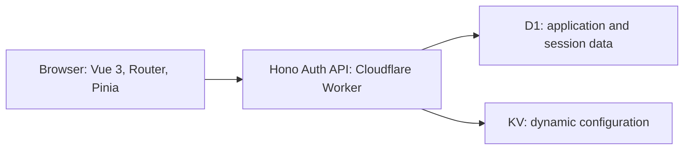

# Vue 3 Browser Hono Auth API Cloudflare Worker

[](https://github.com/dangkhoa2016/Vue-3-Browser-Hono-Auth-API-Cloudflare-Worker/actions/workflows/frontend-quality.yml?query=branch%3Amain)
[](LICENSE)

[](#architecture)
[](documents/VERIFICATION_AND_RELEASES.md)
[](#cloudflare-staging)
[](#run-locally)
[](#i18n-and-vue-quality-tools)

**English** | [Tiếng Việt](README.vi.md)

A browser-based administration interface for the [Hono Auth API on Cloudflare Workers](https://github.com/dangkhoa2016/Hono-Auth-API-Cloudflare-Worker). It covers account management, role-based API discovery, audit and security operations, monitoring, and configuration administration.

Vue single-file components run directly in the browser through `vue3-sfc-loader`. There is no application build step or frontend npm installation. Runtime libraries are loaded from pinned CDN URLs; npm dependencies in `tests/` belong to the verification tools.

[Architecture guide](documents/FRONTEND_ARCHITECTURE_BOUNDARIES.md) · [Documentation index](documents/DOCUMENTATION_INDEX.md)

## Features

- **Accounts and sessions:** login, registration, logout, profile editing, password changes, and email-change verification through the backend.
- **API Explorer:** show endpoints available to the current role and a sign-in prompt when authentication is required.
- **Administration:** manage users and roles, inspect audit records and security incidents, and view system health and statistics. Reset lower-role account passwords in a separate confirmation dialog; the backend revokes all sessions for that account. [Guide](documents/ADMIN_PASSWORD_RESET.md).
- **Operations:** advanced audit, monitoring controls, KV configuration, environment comparison, rate limits, and token administration. Optional operations depend on capabilities confirmed by the backend.
- **Interface:** responsive layouts, light/dark themes, and English, Vietnamese, Japanese, Korean, and German translations.

The Home page introduces the architecture and links to the source and documentation. Public health, version, and language views are also available. The backend enforces permissions; frontend navigation is not an authorization boundary.

## Architecture



This repository contains the frontend. The [backend repository](https://github.com/dangkhoa2016/Hono-Auth-API-Cloudflare-Worker) owns authentication, account provisioning, database migrations, email delivery, and server-side configuration. See [API compatibility and supported runtime](documents/VERIFICATION_AND_RELEASES.md) for the session contract and optional capabilities.

| Path | Responsibility |
| --- | --- |
| `index.html` | Browser entry point and initial CDN resources |
| `assets/js/init.js`, `assets/js/router.js` | Application startup and hash-based routing |
| `assets/js/api/` | Endpoint definitions, HTTP transport, backend contract, and mock API |
| `assets/js/stores/` | Pinia authentication, preferences, and feature state |
| `assets/js/locales/` | The five supported locale dictionaries |
| `assets/data/`, `assets/css/`, `assets/img/` | Mock responses, styles, and images |
| `vue/pages/`, `vue/components/`, `vue/composables/` | Page templates, reusable UI, and page behavior |
| `tools/` | Local server, staging packaging, and quality/verification commands |
| `tests/` | Separate npm manifest, regression suites, and Playwright harness |
| `documents/`, `reports/` | Guides and preserved verification evidence |

## Run locally

Use **Node.js 24** for the local server and verification tools. The browser needs Internet access to load the pinned CDN libraries. Authentication requires Web Locks and readable/writable localStorage in an HTTPS secure context or on localhost. See the [runtime support guide](documents/VERIFICATION_AND_RELEASES.md) for the verification scope.

1. Set up the [backend](https://github.com/dangkhoa2016/Hono-Auth-API-Cloudflare-Worker#readme) with its database, environment configuration, and accounts. Start its API separately on `127.0.0.1:8787`.
2. Clone and start the frontend:

   ```bash
   git clone https://github.com/dangkhoa2016/Vue-3-Browser-Hono-Auth-API-Cloudflare-Worker.git
   cd Vue-3-Browser-Hono-Auth-API-Cloudflare-Worker
   node tools/dev-local.mjs
   ```

3. Open **http://localhost:4173**. Use **http://localhost:4173/#/api-info** to open API Explorer.

The local server selects real API mode and proxies `/backend/` to `127.0.0.1:8787`. It serves only `index.html`, `assets/`, and `vue/`. Change the frontend port with `PORT=4174 node tools/dev-local.mjs`; the backend upstream remains on port `8787`.

Login credentials come from the selected backend's accounts. JSON fixtures are sample data and do not provision accounts in a deployed service.

## API settings and mock mode

Open **Settings** (`/#/settings`) to select the API base URL. Signed-out visitors can edit the endpoint; the full settings page is reserved for admin and super admin accounts. Switch mock/real mode with the toggle in the navigation bar. Endpoint definitions already contain paths such as `/api/auth/login`; use the backend's base URL rather than adding an extra `/api` prefix. Changing the backend requires signing in for that backend.

The local launcher and staging package reapply their configured API URL and real mode on every full page load. A Settings change does not override that startup configuration permanently.

For standalone mock exploration, serve the public application files at an HTTP(S) origin root and select mock mode with the navigation toggle. The unconfigured static entry defaults to mock mode; its real-API fallback is `http://localhost:8788/`. Use the local launcher or an explicit API setting when connecting a real backend. Open the application through HTTP(S), not `file://`.

## Verification

Install the verification dependencies from the repository root:

```bash
npm --prefix tests ci --ignore-scripts --no-audit --no-fund
npm --prefix tests run setup:verification
npm --prefix tests exec -- playwright install chromium
npm --prefix tests run test:all
```

`test:all` runs **static → unit → browser → history**, stopping at the first failure. The unit command includes the real Axios loopback tests.

| Command | Scope |
| --- | --- |
| `npm --prefix tests run test:static` | Vue size/lint/script-setup checks, i18n, CDN pins, and historical report validation |
| `npm --prefix tests run test:unit` | Every `tests/regression/*.test.mjs` suite, including loopback transport |
| `npm --prefix tests run test:loopback` | Only the real Axios loopback transport suite |
| `npm --prefix tests run test:browser` | Chromium against this frontend and a controlled mock API |
| `npm --prefix tests run test:history` | Explicit local source dependencies across the maintained commit history |
| `npm --prefix tests run test:integration` | Opt-in checks against a separately prepared real backend |

A direct browser run skips the wrapper-identity check unless `FRONTEND_SERVED_DIGEST` is supplied; CI supplies it. Mock API passes do not certify a deployed backend. Integration prerequisites and pending-result semantics are documented in the [verification guide](documents/VERIFICATION_AND_RELEASES.md) and [integration configuration](tests/browser/playwright.integration.config.mjs).

Historical checkpoints are verified and restored offline from a pinned bundle. After changing source inputs, explicitly refresh derived comparisons with `npm --prefix tests run reports:refresh`; keep the original evidence intact. See [HISTORY.md](HISTORY.md) before interpreting historical results.

## i18n and Vue quality tools

```bash
node tools/i18n.js audit             # Compare locale structure
node tools/i18n.js usage --detail    # Find source keys missing from locales
node tools/i18n.js check             # Run both checks
node tools/vue-file-size-check.cjs
node tools/vue-custom-lint.cjs
node tools/vue-script-setup-coverage.cjs
```

The i18n CLI supports `--lang=en` / `--lang=vi`; usage checks also accept `--locale=vi`. Vue size limits default to **600 lines per page** and **450 lines per component**. See [settings, i18n, and quality](documents/SETTINGS_I18N_AND_QUALITY.md) for details.

GitHub Actions requires `Static and unit`, `History integrity`, and `Chromium` through [frontend-quality.yml](.github/workflows/frontend-quality.yml). Separate [i18n](.github/workflows/i18n-check.yml) and [Vue quality](.github/workflows/vue-quality-check.yml) workflows run when their configured paths change.

## Cloudflare staging

With an authenticated Wrangler CLI and the target Cloudflare account configured, run:

```bash
STAGING_API_URL=https://YOUR-STAGING-API.workers.dev node tools/prepare-staging.mjs
wrangler deploy --config wrangler.staging.jsonc
```

The script packages only `index.html`, `assets/`, and `vue/` into `.staging-dist/`, selects the HTTPS API URL, and disables mock mode. The provided configuration deploys the `vue-hono-auth-staging` Worker. Add the frontend origin to the backend's `CORS_ORIGIN`. See the [staging instructions in Vietnamese](STAGING.vi.md).

This is a staging configuration. Production needs its own frontend deployment configuration and backend resources, secrets, account provisioning, and email/rate-limit policies. Backend secrets stay in the backend Worker. See [staging and production acceptance](documents/VERIFICATION_AND_RELEASES.md#staging-and-production).

## Documentation and contribution

- [Architecture boundaries](documents/FRONTEND_ARCHITECTURE_BOUNDARIES.md)
- [Runtime and component loading](documents/APP_RUNTIME_AND_LOADING.md)
- [Authentication and sessions](documents/AUTH_AND_SESSION_FLOW.md)
- [API access and mock data](documents/DATA_ACCESS_AND_MOCK_API.md)
- [Audit and advanced audit](documents/ADMIN_AUDIT_AND_ADVANCED_AUDIT.md)
- [Monitoring and dashboard](documents/REALTIME_MONITORING_AND_DASHBOARD.md)
- [KV configuration workflow](documents/KV_ADMIN_CONFIGS_WORKFLOW.md)
- [Project review guide](documents/PROJECT_REVIEW_GUIDE.md)
- [Contribution requirements](CONTRIBUTING.md) and [curated history](HISTORY.md)

Use a conventional commit subject and a bullet body. Keep the history linear and committer timestamps aligned with author timestamps. Preserved historical dates describe curated snapshots; they are not proof that every line was written at that time.

## License

The project source code is licensed under the [MIT License](LICENSE), copyright 2026 Đăng Khoa <i.am@dangkhoa.dev>. Third-party icons retain their original license terms and are covered separately by [LICENSE-ICONS.md](LICENSE-ICONS.md).

### Icon attribution

The icons `assets/img/favicon.ico` and `assets/img/favicon.png` were downloaded from [Application icon on Magnific](https://www.magnific.com/icon/application_14970641), by [juicy_fish](https://www.magnific.com/author/juicy-fish).

See [LICENSE-ICONS.md](LICENSE-ICONS.md) for the bilingual attribution notice. The icons remain subject to the source asset's license and usage terms; attribution does not grant additional rights.
