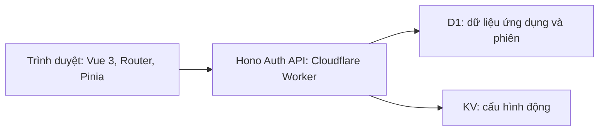

# Vue 3 Browser Hono Auth API Cloudflare Worker

[](https://github.com/dangkhoa2016/Vue-3-Browser-Hono-Auth-API-Cloudflare-Worker/actions/workflows/frontend-quality.yml?query=branch%3Amain)
[](LICENSE)

[](#kiến-trúc)
[](documents/VERIFICATION_AND_RELEASES.md)
[](#staging-trên-cloudflare)
[](#chạy-local)
[](#công-cụ-i18n-và-chất-lượng-vue)

[English](README.md) | **Tiếng Việt**

Giao diện quản trị chạy trên trình duyệt dành cho [Hono Auth API trên Cloudflare Workers](https://github.com/dangkhoa2016/Hono-Auth-API-Cloudflare-Worker). Ứng dụng hỗ trợ quản lý tài khoản, khám phá API theo vai trò, audit, vận hành bảo mật, giám sát và quản trị cấu hình.

Các single-file component của Vue chạy trực tiếp trên trình duyệt qua `vue3-sfc-loader`. Ứng dụng không cần bước build hay cài npm cho frontend. Thư viện lúc chạy được tải từ CDN đã ghim phiên bản; các dependency npm trong `tests/` dành cho công cụ kiểm chứng.

[Hướng dẫn kiến trúc](documents/FRONTEND_ARCHITECTURE_BOUNDARIES.vi.md) · [Mục lục tài liệu](documents/DOCUMENTATION_INDEX.vi.md)

## Chức năng

- **Tài khoản và phiên:** đăng nhập, đăng ký, đăng xuất, sửa hồ sơ, đổi mật khẩu và xác minh thay đổi email qua backend.
- **API Explorer:** hiển thị endpoint phù hợp với vai trò hiện tại và lời nhắc đăng nhập khi cần xác thực.
- **Quản trị:** quản lý người dùng và vai trò, xem bản ghi audit và sự cố bảo mật, theo dõi sức khỏe hệ thống và thống kê. Đặt lại mật khẩu tài khoản có quyền thấp hơn bằng modal xác nhận riêng; backend thu hồi mọi phiên của tài khoản đó. [Hướng dẫn](documents/ADMIN_PASSWORD_RESET.vi.md).
- **Vận hành:** audit nâng cao, điều khiển giám sát, cấu hình KV, đối chiếu môi trường, giới hạn tần suất và quản trị token. Các thao tác tùy chọn phụ thuộc vào khả năng mà backend xác nhận hỗ trợ.
- **Giao diện:** bố cục responsive, chế độ sáng/tối, cùng bản dịch tiếng Anh, Việt, Nhật, Hàn và Đức.

Trang Home giới thiệu kiến trúc và liên kết đến mã nguồn, tài liệu. Các trang sức khỏe hệ thống, phiên bản và ngôn ngữ công khai cũng có sẵn. Backend thực thi phân quyền; menu điều hướng frontend không thay thế việc kiểm tra quyền.

## Kiến trúc



Repository này chứa frontend. [Repository backend](https://github.com/dangkhoa2016/Hono-Auth-API-Cloudflare-Worker) phụ trách xác thực, cấp tài khoản, migration database, gửi email và cấu hình phía server. Xem [khả năng tương thích API và môi trường hỗ trợ, bằng tiếng Anh](documents/VERIFICATION_AND_RELEASES.md) để biết hợp đồng phiên và các khả năng tùy chọn.

| Đường dẫn | Trách nhiệm |
| --- | --- |
| `index.html` | Điểm khởi động trên trình duyệt và các tài nguyên CDN ban đầu |
| `assets/js/init.js`, `assets/js/router.js` | Khởi tạo ứng dụng và định tuyến bằng URL hash |
| `assets/js/api/` | Định nghĩa endpoint, HTTP transport, hợp đồng backend và mock API |
| `assets/js/stores/` | Trạng thái Pinia cho xác thực, tùy chọn và từng chức năng |
| `assets/js/locales/` | Từ điển của năm ngôn ngữ được hỗ trợ |
| `assets/data/`, `assets/css/`, `assets/img/` | Response mẫu, style và hình ảnh |
| `vue/pages/`, `vue/components/`, `vue/composables/` | Template trang, UI tái sử dụng và logic của trang |
| `tools/` | Server local, đóng gói staging và các lệnh kiểm tra chất lượng |
| `tests/` | Manifest npm riêng, bộ kiểm thử hồi quy và công cụ Playwright |
| `documents/`, `reports/` | Hướng dẫn và bằng chứng kiểm chứng được lưu giữ |

## Chạy local

Dùng **Node.js 24** cho server local và công cụ kiểm chứng. Trình duyệt cần Internet để tải thư viện CDN đã ghim phiên bản. Đăng nhập cần Web Locks và localStorage đọc/ghi được trong secure context HTTPS hoặc trên localhost. Xem [hướng dẫn môi trường hỗ trợ, bằng tiếng Anh](documents/VERIFICATION_AND_RELEASES.md) để biết phạm vi đã kiểm chứng.

1. Thiết lập [backend](https://github.com/dangkhoa2016/Hono-Auth-API-Cloudflare-Worker#readme), bao gồm database, cấu hình môi trường và tài khoản. Khởi động API riêng tại `127.0.0.1:8787`.
2. Clone và khởi động frontend:

   ```bash
   git clone https://github.com/dangkhoa2016/Vue-3-Browser-Hono-Auth-API-Cloudflare-Worker.git
   cd Vue-3-Browser-Hono-Auth-API-Cloudflare-Worker
   node tools/dev-local.mjs
   ```

3. Mở **http://localhost:4173**. Dùng **http://localhost:4173/#/api-info** để mở API Explorer.

Server local chọn API thật và chuyển tiếp `/backend/` đến `127.0.0.1:8787`. Server chỉ phục vụ `index.html`, `assets/` và `vue/`. Đổi cổng frontend bằng `PORT=4174 node tools/dev-local.mjs`; cổng backend được chuyển tiếp vẫn là `8787`.

Thông tin đăng nhập đến từ tài khoản của backend đang được chọn. Các fixture JSON là dữ liệu mẫu và không tạo tài khoản trên dịch vụ đã triển khai.

## Cài đặt API và chế độ mock

Mở **Cài đặt** (`/#/settings`) để chọn URL gốc của API. Khi chưa đăng nhập, bạn có thể sửa endpoint; trang cài đặt đầy đủ dành cho tài khoản admin và super admin. Đổi chế độ mock/thật bằng nút chuyển trên thanh điều hướng. Định nghĩa endpoint đã có các đường dẫn như `/api/auth/login`; dùng URL gốc của backend thay vì thêm một tiền tố `/api` nữa. Khi đổi backend, cần đăng nhập cho backend đó.

Server local và gói staging áp dụng lại URL API cùng chế độ thật đã cấu hình mỗi lần tải lại toàn bộ trang. Thay đổi trong Cài đặt không ghi đè vĩnh viễn cấu hình khởi động này.

Để khám phá giao diện bằng mock độc lập, phục vụ các file công khai của ứng dụng tại đường dẫn gốc của một origin HTTP(S), rồi chọn chế độ mock bằng nút chuyển trên thanh điều hướng. Điểm khởi động static chưa cấu hình mặc định dùng mock; URL dự phòng cho API thật là `http://localhost:8788/`. Khi kết nối backend thật, dùng server local hoặc đặt URL API rõ ràng. Mở ứng dụng qua HTTP(S), không dùng `file://`.

## Kiểm chứng

Cài dependency kiểm chứng từ thư mục gốc repository:

```bash
npm --prefix tests ci --ignore-scripts --no-audit --no-fund
npm --prefix tests run setup:verification
npm --prefix tests exec -- playwright install chromium
npm --prefix tests run test:all
```

`test:all` chạy **static → unit → browser → history**, dừng ở lỗi đầu tiên. Lệnh unit đã bao gồm kiểm thử Axios thật với server loopback.

| Lệnh | Phạm vi |
| --- | --- |
| `npm --prefix tests run test:static` | Kiểm tra kích thước/lint/script setup của Vue, i18n, phiên bản CDN và báo cáo lịch sử |
| `npm --prefix tests run test:unit` | Toàn bộ `tests/regression/*.test.mjs`, bao gồm HTTP transport loopback |
| `npm --prefix tests run test:loopback` | Riêng bộ Axios thật với server loopback |
| `npm --prefix tests run test:browser` | Chromium với frontend hiện tại và mock API được kiểm soát |
| `npm --prefix tests run test:history` | Dependency source nội bộ được khai báo tường minh xuyên suốt lịch sử commit đang duy trì |
| `npm --prefix tests run test:integration` | Kiểm tra bật riêng với backend thật đã được chuẩn bị |

Lệnh browser trực tiếp bỏ qua bước kiểm tra định danh của wrapper nếu chưa cấp `FRONTEND_SERVED_DIGEST`; CI có cấp biến này. Kết quả đạt với mock API không xác nhận backend đã triển khai hoạt động đúng. Điều kiện chạy integration và cách ghi nhận kết quả chờ được mô tả trong [hướng dẫn kiểm chứng bằng tiếng Anh](documents/VERIFICATION_AND_RELEASES.md) và [cấu hình integration](tests/browser/playwright.integration.config.mjs).

Các checkpoint lịch sử được xác minh và khôi phục offline từ bundle đã ghim. Sau khi đổi các đầu vào source, chủ động tạo lại bản đối chiếu dẫn xuất bằng `npm --prefix tests run reports:refresh`; giữ nguyên bằng chứng gốc. Đọc [HISTORY.vi.md](HISTORY.vi.md) trước khi diễn giải kết quả lịch sử.

## Công cụ i18n và chất lượng Vue

```bash
node tools/i18n.js audit             # Đối chiếu cấu trúc locale
node tools/i18n.js usage --detail    # Tìm key source còn thiếu trong locale
node tools/i18n.js check             # Chạy cả hai bước
node tools/vue-file-size-check.cjs
node tools/vue-custom-lint.cjs
node tools/vue-script-setup-coverage.cjs
```

CLI i18n hỗ trợ `--lang=en` / `--lang=vi`; kiểm tra usage còn nhận `--locale=vi`. Giới hạn kích thước Vue mặc định là **600 dòng mỗi page** và **450 dòng mỗi component**. Xem [cài đặt, i18n và chất lượng](documents/SETTINGS_I18N_AND_QUALITY.vi.md) để biết chi tiết.

GitHub Actions yêu cầu `Static and unit`, `History integrity` và `Chromium` qua [frontend-quality.yml](.github/workflows/frontend-quality.yml). Hai workflow [i18n](.github/workflows/i18n-check.yml) và [chất lượng Vue](.github/workflows/vue-quality-check.yml) chạy khi các đường dẫn được cấu hình có thay đổi.

## Staging trên Cloudflare

Sau khi có Wrangler CLI đã xác thực và cấu hình tài khoản Cloudflare đích, chạy:

```bash
STAGING_API_URL=https://YOUR-STAGING-API.workers.dev node tools/prepare-staging.mjs
wrangler deploy --config wrangler.staging.jsonc
```

Script chỉ đóng gói `index.html`, `assets/` và `vue/` vào `.staging-dist/`, chọn URL API HTTPS và tắt mock. Cấu hình có sẵn triển khai Worker `vue-hono-auth-staging`. Thêm origin frontend vào `CORS_ORIGIN` của backend. Xem [hướng dẫn staging](STAGING.vi.md).

Đây là cấu hình staging. Production cần cấu hình triển khai frontend riêng, cùng tài nguyên backend, secrets, cách cấp tài khoản và chính sách email/giới hạn tần suất riêng. Secrets của backend được giữ trong Worker backend. Xem [kiểm chứng staging và production, bằng tiếng Anh](documents/VERIFICATION_AND_RELEASES.md#staging-and-production).

## Tài liệu và đóng góp

- [Ranh giới kiến trúc](documents/FRONTEND_ARCHITECTURE_BOUNDARIES.vi.md)
- [Runtime và cơ chế tải component](documents/APP_RUNTIME_AND_LOADING.vi.md)
- [Xác thực và phiên](documents/AUTH_AND_SESSION_FLOW.vi.md)
- [Truy cập API và dữ liệu mock](documents/DATA_ACCESS_AND_MOCK_API.vi.md)
- [Audit và audit nâng cao](documents/ADMIN_AUDIT_AND_ADVANCED_AUDIT.vi.md)
- [Giám sát và dashboard](documents/REALTIME_MONITORING_AND_DASHBOARD.vi.md)
- [Luồng cấu hình KV](documents/KV_ADMIN_CONFIGS_WORKFLOW.vi.md)
- [Hướng dẫn review dự án](documents/PROJECT_REVIEW_GUIDE.vi.md)
- [Yêu cầu đóng góp](CONTRIBUTING.vi.md) và [lịch sử đã biên tập](HISTORY.vi.md)

Dùng tiêu đề commit theo Conventional Commits và phần mô tả dạng bullet. Giữ lịch sử tuyến tính và committer timestamp bằng author timestamp. Ngày lịch sử được giữ lại mô tả các snapshot đã biên tập; chúng không chứng minh mọi dòng mã đều được viết tại thời điểm hiển thị.

## Giấy phép

Mã nguồn dự án được cấp phép theo [MIT License](LICENSE), bản quyền 2026 Đăng Khoa <i.am@dangkhoa.dev>. Các icon của bên thứ ba giữ nguyên điều khoản giấy phép gốc và được ghi nhận riêng trong [LICENSE-ICONS.md](LICENSE-ICONS.md).

### Ghi công icon

Hai icon `assets/img/favicon.ico` và `assets/img/favicon.png` được tải từ [Application icon trên Magnific](https://www.magnific.com/icon/application_14970641), do [juicy_fish](https://www.magnific.com/author/juicy-fish) thiết kế.

Xem [LICENSE-ICONS.md](LICENSE-ICONS.md) để đọc thông báo ghi công song ngữ. Các icon vẫn tuân theo giấy phép và điều khoản sử dụng của tài nguyên gốc; việc ghi công không cấp thêm quyền sử dụng.
